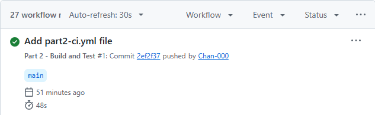

# RaceDay Event Management System

## Project Description
RaceDay is a web-based Event Management System that is designed to support road running, walking, and cycling events in South Africa. The system allows Organisers to manage events, categories, participant enrolments, and results. Participants can register for events, select an event category, view their enrolments, and track their results.
This repository contains the planning and database work completed for PART 1 of the RaceDay project.

## User Roles

### Organiser
Organisers are responsible for managing events and participant information. They can:-
- Create, edit and delete events
- Manage event categories
- View all enrolments for their events
- Capture participant results
  
### Participant
Participants use the system to: -
- Create an account and log in
- Browse available events
- Enrol in an event by selecting a category
- View their own enrolments
- Track personal race results

## Part 1
Part 1 focuses on the planning and database design of the RaceDay system.

The following deliverables are included: -

1. Entity Relationship Diagram (ERD)
2. API Endpoint Plan
3. SQL Server Database Script
4. GitHub repository and GitHub Actions CI validation

## Repository Structure
RaceDay-System_PROG6212/
├── docs/
│   ├── RaceDay_ERD.pdf
│   ├── RaceDay_API_Endpoint_Plan.pdf
│   └── RaceDay_Database.sql
├── .github/
│   └── workflows/
│       └── part1-ci.yml
└── README.md

## Database Setup
1. Open SQL Server Management Studio (SSMS)
2. Connect to your local SQL Server instance
3. Open the file 'docs/RaceDay_Database.sql'
4. Execute the entire script or press 5
5. View the inserted sample data using SELECT queries

## GitHub Actions (CI/CD)
A GitHub Action validates the required Part 1 documentation and repository structure.

The Part 1 workflow checks that the following files and folders exist:-
- docs/
- docs/RaceDay_ERD.pdf
- docs/RaceDay_API_Endpoint_Plan.pdf
- docs/RaceDay_Database.sql
- README.md

- CI Build Status

## YouTube Link
https://youtu.be/hYTrZHQ9RjA

## Part 2

### Technologies Used
- ASP.NET Core Web API
- .NET 8
- Entity Framework Core 
- SQL Server
- Swagger and OpenAPI
- xUnit for Unit testing
- Git and GitHub

### Project Structure
- 'RaceDay.API' -- Main Web API project
- 'RaceDay.Contracts -- DTOs
- 'RaceDay.Api.Tests' -- Unit Tests
- 'docs' -- Part 1 planning documents
RaceDay
|
|-- docs
| |-- RaceDay_ERD.pdf
| |-- RaceDay_API_Endpoint_Plan.pdf
| `-- RaceDay_Database.sql
|
|-- RaceDay.Api
| |-- Controllers
| |-- Data
| |-- Migrations
| |-- Models
| |-- appsettings.json
| `-- Program.cs
|
|-- RaceDay.Contracts
| `-- Dtos -- Dtos.cs
|
|-- RaceDay.Api.Tests
| `-- RaceDayApiTests.cs
| `-- RaceDayWebApplicationFactory.cs
|
|-- .github
| `-- workflows
|  `-- Part1-ci.yml
|  `-- Part2-ci.yml 
|
`-- README.md

### Database Setup
1. Start your SQL Server instance (SSMS)
2. Create or prepare the 'RaceDayDb' database using the project existing database setup and migrations
3. Update the API connection string to match your SQL server instance
4. Apply any required Entity Framework Core migrations
5.  Confirm that the database tables exists

### Authentication
- Users cab register as an Organiser or Participant
- Password are hashed
- Login creates a server side session containing 'UserId' and 'Role'
- Role based access is enfored on protected endpoints

### API EndPoints
- Auth: Register, Login, Logout
- User Profiles: View and Update own profile
- Events: create, view, update and delete events
- EventTypes: contains types of events
- Categories: manage categories per events
- Enrolments: Participants can enrol, Organisers can view
- Results: Organisers captures results and Participants view their own.

### Swagger
Swagger provides an interactive interface for inspecting and testing the API endpoints. 

### Unit Testing
The project includes automated tests for API functionality, authentication and access control.

To run tests locally:

1. Open the Solution Visual Studio
2. Open Test Explorer
3. Select Run All
4. Confirm that the test pass

### CI/CD
Github Actions workflow automatically builds the solution and run all unit tests on every push.

### GitHub Actions Screenshot

### Youtube Link (part2)
https://youtu.be/1EV88q-0XOM