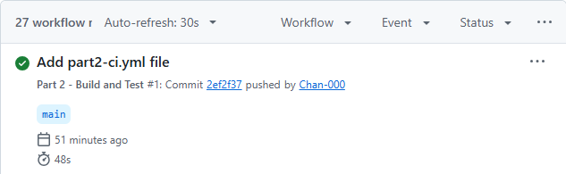
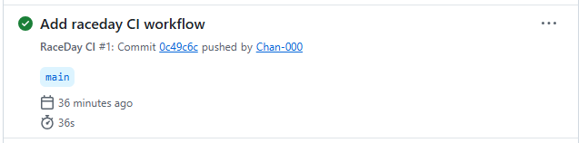

# RaceDay Event Management System

## Project Description
RaceDay is a web-based Event Management System that is designed to support road running, walking, and cycling events in South Africa. The system provides a platform where Organisers can manage events, categories, participant enrolments and race results. Participants can create accounts, browse available events, enrol in events, select categories and track their personal results.

The project was developed in three parts:
- Part 1: Planning and database design.
- Part 2: Development of the RESTful Web API.
- Part 3: Development of the MVC web application, Docker deployment and CI/CD integration

## User Roles

### Organiser
Organisers are responsible for managing events and participant information. They can:-
- Create, edit and delete events
- Manage event categories
- View all enrolments for their events
- Capture participant results
  
### Participant
Participants use the system to: -
- Create an account and log in
- Browse available events
- Enrol in an event by selecting a category
- View their own enrolments
- Track personal race results

## Part 1
Part 1 focuses on the planning and database design of the RaceDay system.

The following deliverables are included: -

1. Entity Relationship Diagram (ERD)
2. API Endpoint Plan
3. SQL Server Database Script
4. GitHub repository and GitHub Actions CI validation

## Solution Structure
The RaceDay solution contains the following main projects and folders:

RaceDay/
│
├── docs/
│   ├── RaceDay_ERD.pdf
│   ├── RaceDay_API_Endpoint_Plan.pdf
│   └── RaceDay_Database.sql
│
├── RaceDay.Api/
│   ├── Controllers/
│   ├── Data/
│   ├── Migrations/
│   ├── Models/
│   ├── appsettings.json
│   └── Program.cs
│
├── RaceDay.Contracts/
│   └── Dtos/
│       └── Dtos.cs
│
├── RaceDay.Api.Tests/
│   ├── RaceDayApiTests.cs
│   └── RaceDayWebApplicationFactory.cs
│
├── RaceDay.Mvc/
│   ├── Controllers/
│   ├── Models/
│   ├── Views/
│   ├── wwwroot/
│   ├── Dockerfile
│   └── Program.cs
│
├── .github/
│   └── workflows/
│       ├── Part1-ci.yml
│       ├── Part2-ci.yml
│       └── raceday-ci.yml
│
├── RaceDay.slnx
└── README.md

## Planning and Database
Part 1 focused on the initial planning and database design of the RaceDay system.

The following deliverables were completed:

1. Entity Relationship Diagram (ERD).
2. API Endpoint Plan.
3. SQL Server Database Script.
4. GitHub repository and GitHub Actions CI validation.

The database was designed to support the system's users, events, event types, categories, enrolments and results.

## Database Setup
1. Open SQL Server Management Studio (SSMS)
2. Connect to your local SQL Server instance
3. Open the file 'docs/RaceDay_Database.sql'
4. Execute the entire script or press 5
5. View the inserted sample data using SELECT queries

## GitHub Actions (CI/CD)
A GitHub Action validates the required Part 1 documentation and repository structure.

The Part 1 workflow checks that the following files and folders exist:-
- docs/
- docs/RaceDay_ERD.pdf
- docs/RaceDay_API_Endpoint_Plan.pdf
- docs/RaceDay_Database.sql
- README.md

- CI Build Status

## YouTube Link
https://youtu.be/hYTrZHQ9RjA

## Part 2 - RESTful API

### Technologies Used
- ASP.NET Core Web API
- .NET 8
- Entity Framework Core 
- SQL Server
- Swagger and OpenAPI
- xUnit for Unit testing
- Git and GitHub

### Database Setup
1. Start your SQL Server instance (SSMS)
2. Create or prepare the 'RaceDayDb' database using the project existing database setup and migrations
3. Update the API connection string to match your SQL server instance
4. Apply any required Entity Framework Core migrations
5.  Confirm that the database tables exists

### Authentication
- Users cab register as an Organiser or Participant
- Password are hashed
- Login creates a server side session containing 'UserId' and 'Role'
- Role based access is enfored on protected endpoints

### API EndPoints
- Auth: Register, Login, Logout
- User Profiles: View and Update own profile
- Events: create, view, update and delete events
- EventTypes: contains types of events
- Categories: manage categories per events
- Enrolments: Participants can enrol, Organisers can view
- Results: Organisers captures results and Participants view their own.

### Swagger
Swagger provides an interactive interface for inspecting and testing the API endpoints. 

### Unit Testing
The project includes automated tests for API functionality, authentication and access control.

To run tests locally:

1. Open the Solution Visual Studio
2. Open Test Explorer
3. Select Run All
4. Confirm that the test pass

### CI/CD
Github Actions workflow automatically builds the solution and run all unit tests on every push.

### GitHub Actions Screenshot

### Youtube Link (part2)
https://youtu.be/1EV88q-0XOM

## Part 3 - MVC Web Application

Part 3 focused on developing the RaceDay MVC web application, connecting it to the existing RESTful API, improving the user interface and preparing the application for Docker deployment. The MVC application communicates with the API through RaceDayApiClient. This keeps the API responsible for database operations and business logic while the MVC application handles the user interface.

### Prerequisites
The following software and services are required to run the project:

- Windows 10 or Windows 11.
- .NET 8 SDK.
- SQL Server.
- SQL Server Management Studio (SSMS).
- Visual Studio or Visual Studio Code.
- Git.
- Docker Desktop with the Docker Engine running.
- An Azure Storage account configured for image storage.

### How to Run RaceDay.Api
The API must be running before using the MVC application.

1. Open PowerShell or a terminal.
2. Navigate to the root RaceDay solution folder.
3. Run:
dotnet run --project RaceDay.Api --urls http://0.0.0.0:5000
4. Wait for the API to start.
5. Open Swagger in a browser:
http://localhost:5000/swagger

Keep this terminal running while testing the MVC application in Docker.

### How to Run RaceDay.Mvc Locally

To run the MVC application outside Docker:

1. Open another terminal.
2. Navigate to the RaceDay solution folder.
3. Confirm that the API is running.
4. Ensure the MVC configuration has the correct API base URL. For local HTTPS development, the API address used by the MVC application should match the API's configured HTTPS address, for example https://localhost:7286.
5. Run:
dotnet run --project RaceDay.Mvc
6. Open the local MVC address displayed in the terminal.
The MVC application communicates with the API through its configured ApiSettings:BaseUrl.

### Azure Blob Storage Setup

RaceDay uses Azure Blob Storage to store uploaded images, such as event banners and profile images.

1. To configure image storage:
2. Create or use an existing Azure Storage account.
Configure the required storage connection details and container settings in the API configuration.
3. Keep storage credentials and connection strings private.
4. Do not commit passwords, connection strings or other sensitive credentials to GitHub.
5. Ensure the API can access the configured storage account.

The API handles image storage and retrieval, while the MVC application displays images through the application's image endpoints.

### Docker Setup

Docker is used to containerise the RaceDay MVC application.
The API runs separately on the host machine, while the MVC application runs inside a Docker container.

- Build Image
Open a terminal in the root RaceDay solution folder and run:

docker build -f RaceDay.Mvc/Dockerfile -t raceday-mvc:part3 .

This builds the MVC Docker image using the Dockerfile inside the RaceDay.Mvc project.

- Run Container
First, ensure that the API is running and reachable on port 5000.
Then run:
docker run -d --name raceday-mvc -p 8080:8080 -e ASPNETCORE_ENVIRONMENT=Docker -e ApiSettings__BaseUrl=http://host.docker.internal:5000/ raceday-mvc:part3

Starting the MVC container without a reachable API may allow the website to open, but pages that depend on API data will not function correctly.

To access the application, open:
http://localhost:8080

- Docker Container Management

To view running containers:
docker ps

To view the MVC container logs:
docker logs raceday-mvc

To stop the container:
docker stop raceday-mvc

To start the existing container again:
docker start raceday-mvc

### Authentication and Session Flow

RaceDay uses session-based authentication.

1. A user registers as either an Organiser or Participant.
2. The user logs in using their credentials.
3. The API validates the login details and creates a server-side session.
4. The API session cookie is passed through the MVC API client.
5. The MVC application stores the relevant user information in its own session, including the user ID, role and display name.
6. Navigation and access to features are based on the user's role.
7. Logging out ends the user's session.

The API remains responsible for authentication and protected operations.

### Organiser Features

The Organiser interface provides access to the following functionality:

- View the Organiser Dashboard.
- Create, edit and delete events.
- Manage event information.
- View participant enrolments for events.
- Capture and manage participant results.

### Participant Features

The Participant interface provides access to the following functionality:

- View the available events.
- View event details.
- Enrol in events and select categories.
- View personal event enrolments.
- View personal race results.
- Manage profile information.

### CI/CD
GitHub Actions is used to automate the project's continuous integration process.

The Part 3 workflow:
- Checks out the repository.
- Sets up the .NET 8 environment.
- Restores the required NuGet packages.
- Builds the complete RaceDay solution in Release configuration.
- Runs the API unit tests.

### GitHub Actions Screenshot

### Video Presentation
https://youtu.be/Q-d6atw9l5U